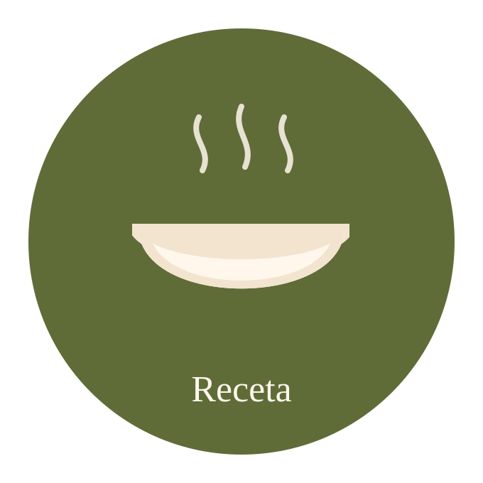
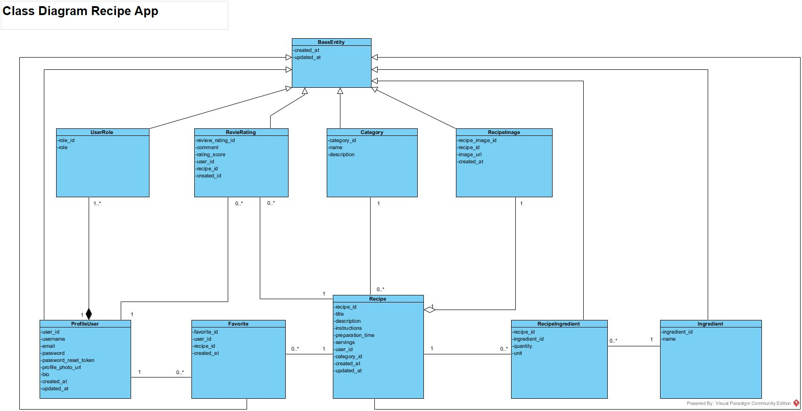

<table>
  <tr>
    <td align="left" valign="middle">
      <h1>Recipe Application – Installatie- en gebruikershandleiding</h1>
    </td>
    <td align="right" valign="middle">
      
    </td>
  </tr>
</table>

<p align="center">
  
</p>

<!-- TOC -->
* [Inhoudsopgave](#inhoudsopgave)
  * [1. Inleiding](#1-inleiding)
    * [GitHub repositories](#github-repositories)
  * [2. Benodigde software](#2-benodigde-software)
    * [2.1 Runtime environments](#21-runtime-environments)
  * [3. Projecten downloaden](#3-projecten-downloaden)
    * [Projectstructuur](#projectstructuur)
  * [4. Backend installeren en configureren](#4-backend-installeren-en-configureren)
    * [4.1 Backend openen in IntelliJ IDEA](#41-backend-openen-in-intellij-idea)
    * [4.2 PostgreSQL installeren](#42-postgresql-installeren)
    * [4.3 Databaseverbinding configureren](#43-databaseverbinding-configureren)
    * [4.4 Omgevingsvariabelen](#44-omgevingsvariabelen)
    * [4.5 Backend starten](#45-backend-starten)
    * [4.6 Swagger API-documentatie](#46-swagger-api-documentatie)
  * [5. Frontend installeren en configureren](#5-frontend-installeren-en-configureren)
    * [5.1 Frontend openen in WebStorm](#51-frontend-openen-in-webstorm)
    * [5.2 Dependencies installeren](#52-dependencies-installeren)
    * [5.3 Omgevingsvariabelen](#53-omgevingsvariabelen)
    * [5.4 Frontend starten](#54-frontend-starten)
  * [6. Applicatie lokaal uitvoeren](#6-applicatie-lokaal-uitvoeren)
  * [7. Rollen en autorisatie](#7-rollen-en-autorisatie)
    * [7.1 Bezoeker](#71-bezoeker)
    * [7.2 USER](#72-user)
    * [7.3 CHEF](#73-chef)
    * [7.4 ADMIN](#74-admin)
  * [8. Autorisatiematrix per endpoint](#8-autorisatiematrix-per-endpoint)
    * [8.1 Eigenaarschap van gebruikersgegevens](#81-eigenaarschap-van-gebruikersgegevens)
  * [9. Databasemodel en relaties](#9-databasemodel-en-relaties)
  * [10. API-documentatie en Postman](#10-api-documentatie-en-postman)
    * [10.1 Swagger](#101-swagger)
    * [10.2 API testen met Postman](#102-api-testen-met-postman)
    * [10.3 HTTP-statuscodes](#103-http-statuscodes)
  * [11. Tests uitvoeren](#11-tests-uitvoeren)
    * [11.1 Backend](#111-backend)
    * [11.2 Frontend](#112-frontend)
  * [12. Veelvoorkomende problemen](#12-veelvoorkomende-problemen)
  * [13. Veiligheid en configuratie](#13-veiligheid-en-configuratie)
  * [14. Bronnen](#14-bronnen)
<!-- TOC --># Inhoudsopgave


## 1. Inleiding

De Recipe Application is een `fullstack` webapplicatie waarmee gebruikers recepten kunnen bekijken, beheren, beoordelen en bewaren.

Het doel van de applicatie is om het gebruik van `losse papieren recepten te verminderen`. Recepten die op papier worden bewaard, kunnen gemakkelijk kwijtraken of onoverzichtelijk worden.

De `web-API` biedt daarom `één centrale en overzichtelijke omgeving waarin gebruikers`, zoals chefs, hun `recepten` digitaal kunnen opslaan, bekijken en beheren. Daarnaast kunnen gebruikers recepten beoordelen, een favorietenlijst bijhouden en eventueel hun `eigen digitale kookboek samenstellen`.


De applicatie bestaat uit vier onderdelen:

- **Keycloak:** Secure Identity and Access Management (OIDC) server voor authenticatie en autorisatie.
- **Frontend:** React en JavaScript.
- **Backend:** Java en Spring Boot.
- **Database:** PostgreSQL.


## Opdrachtbeschrijving


**Het probleem dat ik wil oplossen**

`Alle recepten centraal bewaren` i.p.v. losse papieren

Dit doe ik door een `webAPI te bouwen` die één overzichtelijke en centrale omgeving te creëren waarin alle recepten digitaal worden opgeslagen. Hierdoor raken recepten niet meer kwijt en worden ze beter georganiseerd dan wanneer ze op papier staan.
Tevens kan de `gebruikers (chef)` en `admin` een receptenboek maken en delen met anderen.


### GitHub repositories

| Onderdeel | Repository |
|---|---|
| Frontend | https://github.com/Jhudeska/frontend-recipe-app |
| Backend | https://github.com/Jhudeska/backend-recipe-app |

## 2. Benodigde software

| Software      | Doel                                                                           |
|---------------|--------------------------------------------------------------------------------|
| Git           | Broncode ophalen en beheren                                                    |
| IntelliJ IDEA | Backend ontwikkelen en uitvoeren                                               |
| WebStorm      | Frontend ontwikkelen en uitvoeren                                              |
| Java JDK 25   | Backend runtime                                                                |
| Node.js       | Frontend runtime                                                               |
| npm           | Frontend dependencies                                                          |
| Vite          | Frontend buildtool en development server                                       |
| PostgreSQL    | Relationele database                                                           |
| pgAdmin 4     | Databasebeheer                                                                 |
| Postman       | REST API testen                                                                |
| Keycloack     | Identiteits- en toegangsbeheer, bijvoorbeeld voor authenticatie en autorisatie |

### 2.1 Runtime environments

**Backend**
- Java JDK 25
- Spring Boot 4.1.1
- Maven Wrapper
- Spring Data JPA
- Spring Security
- PostgreSQL

**Frontend**
- React 19.2.8
- Vite 8.3.0
- Node.js 20.19+ of 22.12+
- npm

**Security**
- Keycloak 26.7.4
- Spring Security OAuth2 Resource Server

Controleer de versies:

```bash
java -version
node -v
npm -v
git --version
```

## 3. Projecten downloaden

```bash
git clone https://github.com/Jhudeska/backend-recipe-app.git
git clone https://github.com/Jhudeska/frontend-recipe-app.git
```

[//]: # (### Projectstructuur)

[//]: # ()
[//]: # (```text)

[//]: # (RecipeApplication/)

[//]: # (├── backend-recipe-app/)

[//]: # (│   ├── .mvn/)

[//]: # (│   ├── src/)

[//]: # (│   ├── mvnw)

[//]: # (│   ├── mvnw.cmd)

[//]: # (│   └── pom.xml)

[//]: # (│)

[//]: # (└── frontend-recipe-app/)

[//]: # (    ├── public/)

[//]: # (    ├── src/)

[//]: # (    ├── package.json)

[//]: # (    ├── package-lock.json)

[//]: # (    └── vite.config.js)

[//]: # (    )
[//]: # (    )
[//]: # (```)
### Projectstructuur


<details>
<summary>📁 backend-recipe-app</summary>


- 📁 `recipeapp`
  -  `.mvn`
  -   `src`
  -   `main`
    - `java`
      -  `nl.novi.recipeapp`
        -  `config`
        -  `controllers`
        -  `dtos`
        -  `entities`
        -  `enums`
        - `exceptions`
        - `mappers`
        -  `repositories`
        -  `security`
        -  `utils`
          -  `RecipeappApplication.java`
    -    `resources`
      -   `tests`
        -   `nl.novi.recipeapp`
          -   `controllers`
          -   `services`
            -   `RecipeApplicationTests.java`
    -   `.gitattributes`
    -  `.gitignore`
    -   `mvnw`
    -   `mvnw.cmd`
    -   `pom.xml`
    -   `recipeapp.iml`
  - 📁 `uploads`
    - 📁 `recipes`
      - 📄 `f97eb96c9251.png`
      - 📄 `f674833c9251.png`

</details>

<details>
<summary>📁 frontend-recipe-app</summary>

- 📁 `public`
  -   `src`
  - `api`
  - `assets`
  - `components`
  - `constants`
  - `context`
  - `helpers`
  - `pages`
    -  `App.css`
    -  `App.jsx`
    -  `index.css`
    -  `main.jsx`
  -  `.gitignore`
  -   `eslint.config.js`
  -   `index.html`
  -   `package.json`
  -   `package-lock.json`
  -   `postcss.config.js`
  -   `README.md`
  -   `receta-logo.svg`
  -   `vite.config.js`

</details>


## 4. Backend installeren en configureren

### 4.1 Backend openen in IntelliJ IDEA

1. Open IntelliJ IDEA.
2. Selecteer Open.
3. Open de map `backend-recipe-app`.
4. Wacht totdat Maven de dependencies heeft geladen.
5. Stel Project SDK in op Java 25 en configureer Java_HOME.


### 4.2 PostgreSQL installeren

Installeer PostgreSQL en pgAdmin 4.

Maak de database aan:

```sql
CREATE DATABASE recipe_app;
```

### 4.3 Databaseverbinding configureren

| Variabele | Voorbeeld |
|---|---|
| DB_HOST | localhost |
| DB_PORT | 5432 |
| DB_NAME | recipe_app |
| DB_USERNAME | postgres |
| DB_PASSWORD | Eigen databasewachtwoord |

Voorbeeld `application.properties`:

```properties
spring.datasource.url=jdbc:postgresql://${DB_HOST:localhost}:${DB_PORT:5432}/${DB_NAME:recipe_app}
spring.datasource.username=${DB_USERNAME}
spring.datasource.password=${DB_PASSWORD}

spring.jpa.hibernate.ddl-auto=update
spring.jpa.show-sql=true
spring.jpa.properties.hibernate.dialect=org.hibernate.dialect.PostgreSQLDialect
```

Let op: dit is een voorbeeldconfiguratie. Controleer de bestaande instellingen en migraties in het backendproject.

### 4.4 Omgevingsvariabelen

| Variabele | Beschrijving |
|---|---|
| DB_HOST | Databasehost |
| DB_PORT | PostgreSQL-poort |
| DB_NAME | Databasenaam |
| DB_USERNAME | Databasegebruikersnaam |
| DB_PASSWORD | Databasewachtwoord |
| SERVER_PORT | Backendpoort |
| JWT_ISSUER_URI | JWT issuer URI |
| JWT_JWK_SET_URI | JWK Set URI |
| MAIL_HOST | Mailserver |
| MAIL_PORT | Mailserverpoort |
| MAIL_USERNAME | Mailservergebruikersnaam |
| MAIL_PASSWORD | Mailserverwachtwoord |

Bewaar wachtwoorden en geheime sleutels nooit in GitHub.

### 4.5 Backend starten

Windows:

```bash
mvnw.cmd spring-boot:run
```

macOS/Linux:

```bash
./mvnw spring-boot:run
```

Standaard URL:

`http://localhost:8080`

### 4.6 Swagger API-documentatie

| Onderdeel | URL |
|---|---|
| Swagger UI | http://localhost:8080/swagger-ui/index.html |
| OpenAPI JSON | http://localhost:8080/v3/api-docs |

### 4.7 Keycloak configureren

1. Download de laatste versie van Keycloak.
2. Open cmd of bash.
3. Start Keyclock met de volgende commando's:

```bash
cd keycloak-16.1.1/bin
```
```bash
windows: bin\kc.bat start-dev --http-port=9090
``````bash
unix: bin/kc.sh start-dev --http-port=9090
```

4. Stel Paths in op de juiste locaties.
5. Pas aan in applications.propperties backend.

```properties
client-id=receta-app
spring.security.oauth2.resourceserver.jwt.issuer-uri=http://localhost:9090/realms/receta
spring.security.oauth2.resourceserver.jwt.audience=account
```
6.  Keycloak is bereikbaar op http://localhost:9090.


## 5. Frontend installeren en configureren

### 5.1 Frontend openen in WebStorm

1. Open WebStorm.
2. Selecteer Open.
3. Open de map `frontend-recipe-app`.
4. Open de geïntegreerde terminal.

### 5.2 Dependencies installeren

```bash
npm install
```

### 5.3 Omgevingsvariabelen

Maak indien nodig een `.env`-bestand aan:

```env
VITE_API_BASE_URL=http://localhost:8080
```

De variabelenaam moet overeenkomen met de bestaande frontendconfiguratie.

### 5.4 Frontend starten

```bash
npm run dev
```

Standaard URL:

`http://localhost:5173`

## 6. Applicatie lokaal uitvoeren

1. Start PostgreSQL.
2. Controleer of database `recipe_app` bestaat.
3. Start de backend vanuit IntelliJ IDEA.
4. Controleer `http://localhost:8080`.
5. Start de frontend vanuit WebStorm.
6. Open `http://localhost:5173` in de browser.

## 7. Rollen en autorisatie

De applicatie gebruikt vier toegangsniveaus.

| Rol | Beschrijving |
|---|---|
| Bezoeker | Niet-ingelogde gebruiker |
| USER | Geregistreerde gebruiker |
| CHEF | Beheerder van recepten en inhoud |
| ADMIN | Beheerder met volledige toegang |

### 7.1 Bezoeker

- Recepten bekijken.
- Ingrediënten bekijken.
- Categorieën bekijken.

### 7.2 USER

- Eigen profiel bekijken en aanpassen.
- Eigen favorieten beheren.
- Reviews plaatsen.
- Eigen reviews aanpassen en verwijderen.
- Eigen beoordelingen beheren.

### 7.3 CHEF

- Recepten aanmaken, aanpassen en verwijderen.
- Ingrediënten beheren.
- Categorieën beheren.
- Receptafbeeldingen beheren.
- Recept-ingrediëntrelaties beheren.

### 7.4 ADMIN

- Alle rechten van USER.
- Alle rechten van CHEF.
- Toegang tot alle endpoints.
- Alle gebruikersgegevens beheren.
- Gebruikersrollen beheren.
- Alle applicatiegegevens beheren.

**Belangrijk:** ADMIN heeft ook toegang tot endpoints die oorspronkelijk voor USER en CHEF zijn bedoeld.

## 8. Autorisatiematrix per endpoint

Legenda:
- Iedereen: bezoeker en ingelogde gebruikers.
- Ingelogd: USER, CHEF en ADMIN.
- Eigen gegevens: eigenaar van het record en ADMIN.
- USER: USER en ADMIN.
- CHEF: CHEF en ADMIN.
- ADMIN: uitsluitend ADMIN.

| Endpoint/resource | GET | POST | PUT | DELETE |
|---|---|---|---|---|
| recipes | Iedereen | CHEF | CHEF | CHEF |
| ingredients | Iedereen | CHEF | CHEF | CHEF |
| categories | Iedereen | CHEF | CHEF | CHEF |
| recipe_images | Ingelogd | CHEF | CHEF | CHEF |
| recipe_ingredients | Ingelogd | CHEF | — | CHEF |
| user_profiles | Eigen gegevens | Registratie | Eigen gegevens | Eigen gegevens |
| review_ratings | Ingelogd | USER | Eigen review | Eigen review |
| favorites | Eigen favorieten | USER | — | Eigen favorieten |
| user_profile_roles | ADMIN | ADMIN | ADMIN | ADMIN |

ADMIN krijgt bij alle resources en HTTP-methodes toegang.

### 8.1 Eigenaarschap van gebruikersgegevens

De backend controleert bij `user_profiles`, `favorites` en `review_ratings` of de ingelogde gebruiker eigenaar is van het record.

Voorbeeld: gebruiker met `user_id = 5` mag uitsluitend eigen profielgegevens, favorieten en reviews beheren.

De gebruiker mag niet:
- Het profiel van gebruiker 8 aanpassen.
- Favorieten van gebruiker 8 verwijderen.
- Reviews van andere gebruikers aanpassen of verwijderen.

Gebruik de identiteit van de geauthenticeerde gebruiker voor deze controles. Vertrouw niet uitsluitend op een `user_id` uit de request body of URL.

## 9. Databasemodel en relaties



### 9.1 User_profile

| Kolom | Beschrijving |
|---|---|
| user_id | Primaire sleutel |
| username | Gebruikersnaam |
| email | E-mailadres |
| password | Gehashte wachtwoordwaarde |
| password_reset_token | Token voor wachtwoordherstel |
| profile_photo_url | URL profielfoto |
| bio | Persoonlijke beschrijving |
| created_at | Aanmaakdatum |
| updated_at | Wijzigingsdatum |

### 9.2 User_role

| Kolom | Beschrijving |
|---|---|
| role_id | Primaire sleutel |
| role | Rolnaam |

Beschikbare rollen: USER, CHEF en ADMIN. Bezoeker is geen opgeslagen gebruikersrol.

### 9.3 Recipe

| Kolom | Beschrijving |
|---|---|
| recipe_id | Primaire sleutel |
| title | Titel van het recept |
| description | Beschrijving |
| instructions | Bereidingswijze |
| user_id | Verwijzing naar gebruiker |
| category_id | Verwijzing naar categorie |
| preparation_time | Bereidingstijd |
| servings | Aantal porties |
| created_at | Aanmaakdatum |
| updated_at | Wijzigingsdatum |

### 9.4 Favorite

| Kolom | Beschrijving |
|---|---|
| favorite_id | Primaire sleutel |
| user_id | Verwijzing naar gebruiker |
| recipe_id | Verwijzing naar recept |
| created_at | Aanmaakdatum |

Een gebruiker kan meerdere favorieten hebben. Een recept kan door meerdere gebruikers als favoriet worden opgeslagen.

De combinatie `user_id` en `recipe_id` moet uniek zijn.

### 9.5 Recipe_Image

| Kolom | Beschrijving |
|---|---|
| recipe_image_id | Primaire sleutel |
| recipe_id | Verwijzing naar recept |
| image_url | URL van afbeelding |
| created_at | Aanmaakdatum |

### 9.6 Review_Rating

| Kolom | Beschrijving |
|---|---|
| review_rating_id | Primaire sleutel |
| comment | Reviewtekst |
| rating_score | Beoordelingsscore |
| user_id | Verwijzing naar gebruiker |
| recipe_id | Verwijzing naar recept |
| created_at | Aanmaakdatum |

Een gebruiker kan meerdere reviews schrijven. Een recept kan meerdere reviews ontvangen.

### 9.7 Overige tabellen

- Ingredient
- Category
- Recipe_Ingredient

Deze tabellen ondersteunen de koppeling tussen recepten, ingrediënten en categorieën.

## 10. API-documentatie en Postman

### 10.1 Swagger

| Onderdeel | URL |
|---|---|
| Swagger UI | http://localhost:8080/swagger-ui/index.html |
| OpenAPI JSON | http://localhost:8080/v3/api-docs |

### 10.2 API testen met Postman

1. Open Postman.
2. Maak een nieuwe HTTP-request aan.
3. Vul de backend-URL in.
4. Selecteer de HTTP-methode.
5. Voeg de benodigde headers toe.
6. Voeg eventueel een JSON-request body toe.
7. Verstuur de aanvraag.
8. Controleer de response.

Voor beveiligde endpoints:

```http
Authorization: Bearer <access_token>
Content-Type: application/json
```

### 10.3 HTTP-statuscodes

| Statuscode | Betekenis |
|---|---|
| 200 | Aanvraag succesvol |
| 201 | Resource aangemaakt |
| 204 | Succesvol zonder response body |
| 400 | Ongeldige aanvraag |
| 401 | Niet geauthenticeerd |
| 403 | Onvoldoende rechten |
| 404 | Resource niet gevonden |
| 500 | Interne serverfout |

## 11. Tests uitvoeren

### 11.1 Backend

Windows:

```bash
mvnw.cmd test
```

macOS/Linux:

```bash
./mvnw test
```

### 11.2 Frontend

Lint uitvoeren:

```bash
npm run lint
```

Frontend bouwen:

```bash
npm run build
```

## 12. Veelvoorkomende problemen

| Probleem | Mogelijke oplossing |
|---|---|
| Backend start niet | Controleer Java-versie en Maven-output |
| Databaseverbinding mislukt | Controleer PostgreSQL en databasegegevens |
| Frontend start niet | Controleer Node.js en npm |
| API geeft 401 | Controleer het toegangstoken |
| API geeft 403 | Controleer gebruikersrol en autorisatie |
| Frontend bereikt backend niet | Controleer API-URL en CORS-configuratie |
| Swagger is niet bereikbaar | Controleer backend en OpenAPI-configuratie |

## 13. Veiligheid en configuratie

- Sla wachtwoorden nooit als platte tekst op.
- Gebruik veilige wachtwoordhashing.
- Bewaar geheime sleutels en wachtwoorden buiten GitHub.
- Controleer altijd het eigenaarschap van gebruikersgegevens.
- Beveilig niet-openbare endpoints met Spring Security.
- Geef ADMIN toegang tot alle endpoints.
- Valideer gebruikersinvoer aan de backendzijde.

## 14. Exports

- [postman](https://github.com/Jhudeska)
- [keycloack realm ](https://github.com/Jhudeska)


## 14. Bronnen

- [Frontend repository](https://github.com/Jhudeska/frontend-recipe-app)
- [Backend repository](https://github.com/Jhudeska/backend-recipe-app)
- [Spring Boot](https://spring.io/projects/spring-boot)
- [React](https://react.dev/)
- [PostgreSQL](https://www.postgresql.org/)
- [Postman](https://www.postman.com/)
- [Swagger](https://swagger.io/)
- [Vite](https://vite.dev/)

---


[//]: # (``` java)

[//]: # (public interface TEST<RESPONSE, REQUEST , T extends BaseEntity> {)

[//]: # ()
[//]: # (})

[//]: # (```)

